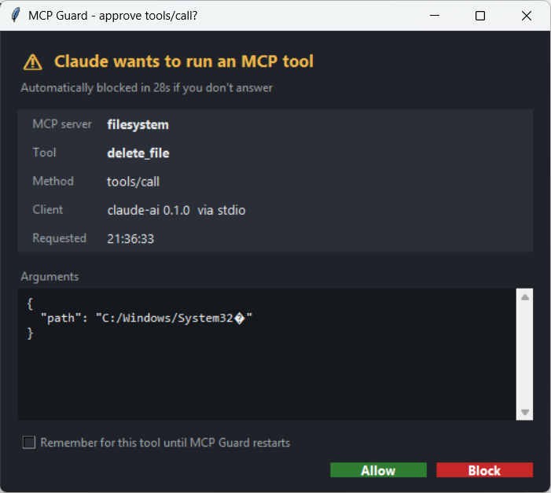

# MCP Guard

MCP Guard is a security middleware that sits between **Claude** (Web and Desktop) and an
**MCP server**. Every time Claude tries to run a tool, MCP Guard holds the request and
shows an always-on-top popup. The tool only runs if you click **Allow**.



This repo is set up with the free, no-login **[Kiwi.com Flights](https://mcp.kiwi.com)** MCP
server and the official **Filesystem** MCP server. Claude can search real flights or touch files,
but only after you approve each call.

MCP Guard covers both ways Claude talks to MCP servers:

```
Remote servers (connectors) - Claude Web and Claude Desktop
  Claude ─▶ Anthropic cloud ─HTTPS─▶ tunnel ─▶ MCP Guard (http_proxy) ─▶ Kiwi Flights MCP
                                                    │
Local servers - Claude Desktop config               ├──▶ popup: Allow / Block
  Claude Desktop ─stdio─▶ MCP Guard (stdio_proxy) ─stdio─▶ Filesystem MCP
```

* **Allow:** the original request is forwarded unchanged, and the result goes back to Claude.
* **Block:** the server never sees the request, and Claude gets "Blocked by MCP Guard".
* **Fails closed:** no answer within 120 s, popup service down, or an error all mean **Block**.
* **Concurrent requests:** one popup per request, answered in any order.
* **Audit log:** every decision is written to `~/.mcp-guard/audit.jsonl`.

MCP Guard is **not** an MCP server. It's the layer in front of one.
See [docs/ARCHITECTURE.md](docs/ARCHITECTURE.md) for the design and
[docs/request-flow.pdf](docs/request-flow.pdf) for a one-page diagram of how a request flows.

---

## Setup (once)

Requirements: Python 3.10+ (with Tkinter, included on Windows and macOS) and
[cloudflared](https://developers.cloudflare.com/cloudflare-one/connections/connect-networks/downloads/) for the public URL.

```bash
python -m pip install -r requirements.txt
```

```bash
winget install --id Cloudflare.cloudflared
```

## Run

```bash
python run_mcp_guard.py start
```

On Windows you can double-click **`start-mcp-guard.bat`** instead.

It starts the popup service and the middleware, opens a public HTTPS tunnel, and prints a URL
(also copied to the clipboard):

```
READY!  Add this URL as a custom connector in Claude:
https://<random>.trycloudflare.com/mcp/<secret>
```

**Keep the window open.** Press **Ctrl+C** to stop.

## Connect Claude

1. In Claude (claude.ai, or Claude Desktop), open **Settings → Connectors → Add custom connector**.
2. Name: `Kiwi Flights (MCP Guard)`. URL: paste the URL from above. Click **Add**.
3. In a new chat, enable the connector and ask: *"Find flights from BOM to GOI next Friday"*.
4. The MCP Guard popup appears on your PC. **Allow** shows real flight prices. **Block** makes Claude say the call was blocked.

Connectors belong to your Claude account, so the same connector works in **Claude Web and
Claude Desktop**. The tunnel URL changes each time you restart, so edit the connector and paste the new one.

## Claude Desktop local servers

Servers listed in `claude_desktop_config.json` run on your PC and never go through a connector.
Guard them with:

```bash
python run_mcp_guard.py install --sandbox ~/mcp-sandbox
```

This wraps every local server in the config with MCP Guard. `--sandbox` also adds the official
Filesystem server, limited to that folder. A backup of the config is written first. Then quit
Claude Desktop from the tray and reopen it, and ask *"Create notes.txt in my mcp-sandbox folder"*.
Click **Block**, and the file is not created. To undo: `python run_mcp_guard.py uninstall`.

## Other commands

| Command | Purpose |
|---|---|
| `python run_mcp_guard.py start --upstream URL --name N` | guard a different MCP server instead of Kiwi |
| `python run_mcp_guard.py start --no-tunnel` | local only, no public URL |
| `python run_mcp_guard.py install [--sandbox DIR]` / `uninstall` | guard / restore Claude Desktop local servers |
| `python run_mcp_guard.py status` | pending requests and recent decisions |
| `python run_mcp_guard.py stop` | stop the popup service (pending requests are blocked) |

## Configuration (optional)

`~/.mcp-guard/config.json`:

```json
{
  "decision_timeout": 120,
  "on_broker_unavailable": "deny",
  "gated_methods": ["tools/call"],
  "rules": [
    {"action": "allow", "server": "kiwi-flights", "tool": "search-flight"}
  ]
}
```

* `rules`: `fnmatch` patterns, first match wins. A matching request skips the popup.
* `gated_methods`: which JSON-RPC methods need approval (default: tool calls).

## Project layout

```
mcp_guard/
  start.py           `start` command: popup service + middleware + tunnel
  http_proxy.py      middleware for remote servers (Streamable-HTTP reverse proxy)
  stdio_proxy.py     middleware for Claude Desktop local servers (stdio)
  desktop_config.py  install / uninstall into claude_desktop_config.json
  broker/
    core.py          decision engine: rules, remember, timeout, cancel
    ui.py            Tkinter popup
    server.py        local API the middleware calls (127.0.0.1, token auth)
    app.py           runs the popup service
  broker_client.py   middleware -> popup service client (auto-start, fail closed)
  protocol.py        JSON-RPC helpers, request/decision types
  config.py          settings, data folder, auth token
  cli.py             command line
docs/ARCHITECTURE.md design write-up
run_mcp_guard.py     launcher
start-mcp-guard.bat  double-click to start (Windows)
```
